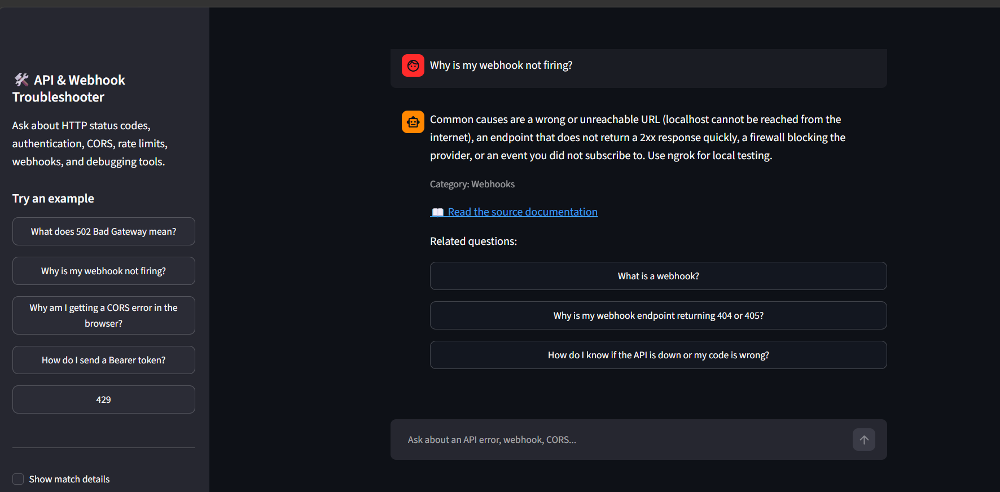
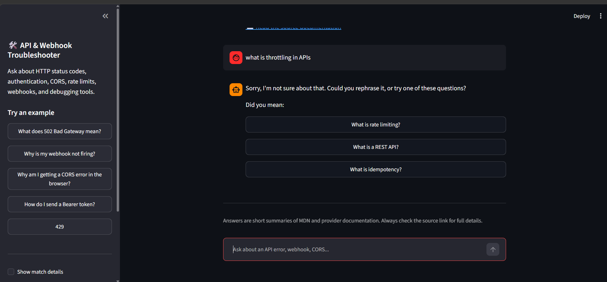
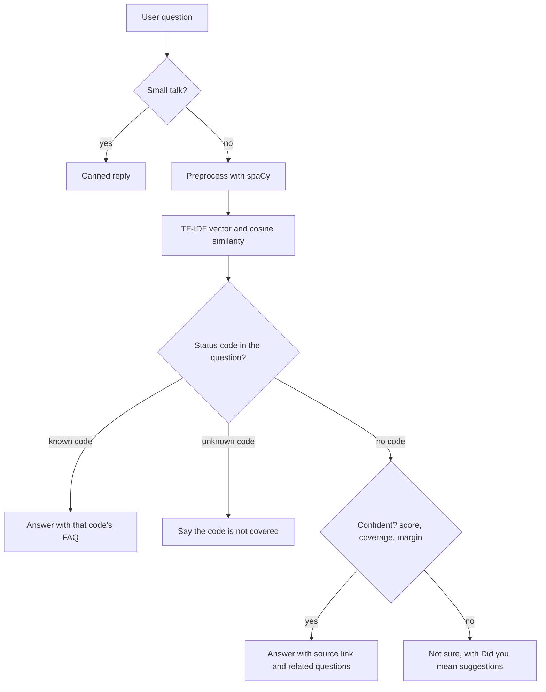
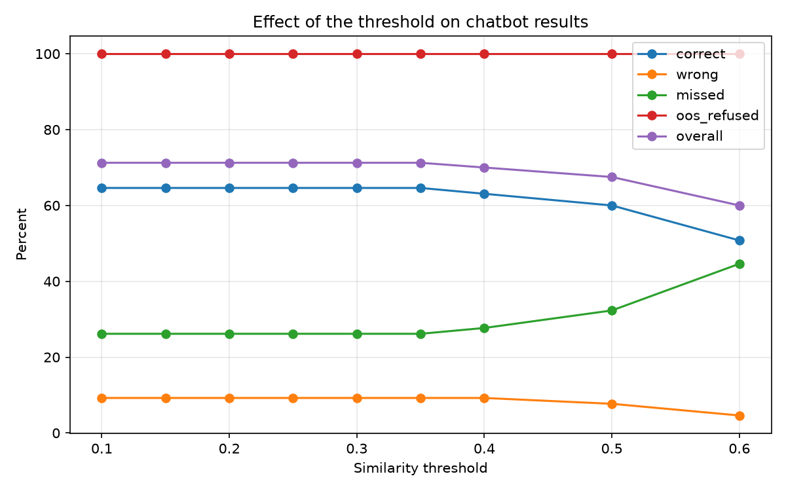

# REST API & Webhook Troubleshooter

An FAQ chatbot that helps developers debug common **REST API and webhook problems**: HTTP status codes, authentication, CORS, rate limits, webhooks, and debugging tools. Every answer links to official documentation.

**Live demo:** TODO-add-your-Streamlit-link-here



> Built for **Task 2: Chatbot for FAQs** (NLP with spaCy, TF-IDF, and cosine similarity).

## Task requirements

- [x] Collect FAQs on a topic: **65 FAQs** (260 question wordings) on REST APIs and webhooks, each with a source link
- [x] Preprocess the text with spaCy: clean, tokenize, remove stopwords, lemmatize
- [x] Match user questions to the most similar FAQ with **TF-IDF + cosine similarity**
- [x] Display the best matching answer as a chatbot response
- [x] Optional: chat UI built with **Streamlit**

## Features

- Answers from **65 FAQs in 8 categories**, with a source link and category on every answer
- Says **"I'm not sure"** and suggests similar questions instead of guessing (coverage, margin, and threshold checks)
- **Status-code shortcut:** typing `404` or "I got a 429" goes straight to the right FAQ, and unknown codes are refused
- **Small-talk intents:** greetings, thanks, "who are you", "what can you do for developers"
- **Evaluation tools:** a held-out test set, experiment runner, and an `explain` command that shows why the bot matched a question
- **31 automated tests** with pytest



## How it works



1. **Collect:** FAQs live in `data/faqs.csv`. Each FAQ is written 4 ways (3 natural wordings and 1 error-message style), and all wordings share one answer and source.
2. **Preprocess (spaCy):** lowercase, remove punctuation, tokenize, remove stopwords, and lemmatize. Numbers such as `401` are kept, and words that change meaning (`not`, `no`, `never`, `without`, `down`) are kept too.
3. **Match:** every FAQ question becomes a TF-IDF vector. The user's question is converted the same way, and cosine similarity finds the closest FAQ.
4. **Decide:** the bot answers only if all three checks pass:
   - similarity score of at least **0.30**
   - at least **60%** of the user's words are known to the FAQ data (*coverage*)
   - the best FAQ beats the runner-up by at least **0.05** (*margin*)
5. **Respond:** the answer, category, and source link, or "not sure" with suggestions.

## Dataset

| Category | FAQs |
|---|---|
| HTTP Status Codes | 16 |
| API Basics | 8 |
| Authentication and Authorization | 8 |
| Webhooks | 8 |
| Debugging Tools and Practices | 7 |
| Headers and Request/Response Format | 6 |
| CORS | 6 |
| Rate Limiting | 6 |

Answers are short summaries written from MDN and provider documentation (Stripe, GitHub, AWS, OWASP). Always check the source link for full details.

## Evaluation

The bot was tested on **80 questions it had never seen** (`data/test_questions.csv`): 65 real questions (one per FAQ, in new wording) and 15 off-topic questions that it should refuse.

| | Baseline | Final |
|---|---|---|
| Correct answers (top-1) | 73.8% | 64.6% |
| Right FAQ in the top 3 | 86.2% | 86.2% |
| Confident wrong answers | 26.2% | 9.2% |
| "Not sure" on real questions | 0.0% | 26.2% |
| Off-topic questions refused | 53.3% | 100% |
| **Misleading answers** (wrong answers plus answered off-topic questions) | **30.0%** | **7.5%** |



### What I tried

Three rounds of experiments (full tables in [`docs/`](docs/)) changed one thing at a time:

| Idea | Result |
|---|---|
| Coverage rule (refuse if too few words are known) | Free win. Refuses off-topic questions without losing correct answers. **Kept at 60%.** |
| Strict unknown status codes | Small free gain. **Kept.** |
| Margin rule (don't guess when two FAQs are close) | Cuts wrong answers sharply, but more "not sure" replies. **Kept at 0.05.** |
| Extra stopwords | Lost correct answers. Dropped. |
| Bigrams (word pairs) | Made results worse on this small dataset. Dropped. |
| Raising the similarity threshold | Barely helped, because wrong answers often scored 0.7 to 0.9. |

**Trade-off:** the final settings give up about 9 points of correct answers to cut misleading answers by about three quarters. For a troubleshooting bot, "I'm not sure" with suggestions is safer than a confident wrong answer, and for 11 of the 17 "not sure" replies the right FAQ appeared among the suggestions.

### Error analysis

Remaining mistakes fall into a few patterns:
- **Paraphrases with no shared words**, such as "url path an api listens on" versus "endpoint"
- **Overlapping FAQs**, especially the webhook ones, which steal answers from each other
- **Off-topic questions with one familiar word**, which the coverage rule now mostly catches

Run `python -m src.explain "your question"` to see exactly why the bot matched (or refused) a question.

## Getting started

Requires **Python 3.12** (spaCy may not support the newest Python versions yet).

```bash
git clone https://github.com/seharrehman97-rgb/faq-chatbot.git
cd faq-chatbot

# Windows
py -3.12 -m venv venv
venv\Scripts\activate
# macOS / Linux
# python3.12 -m venv venv && source venv/bin/activate

pip install -r requirements.txt
```

The spaCy English model is installed by `requirements.txt`, so no separate download is needed.

### Run it

```bash
streamlit run app/app.py     # chat interface in your browser
python -m src.chatbot        # chat in the terminal
```

### Test and evaluate

```bash
pip install -r requirements-dev.txt
python -m pytest -q                       # 31 tests
python -m src.evaluate                    # metrics on the held-out test set
python -m src.experiments                 # compare tuning ideas
python -m src.explain "why is my webhook not firing"
```

## Project structure

```
faq-chatbot/
├── app/app.py            # Streamlit chat interface (display only)
├── data/
│   ├── faqs.csv          # 65 FAQs, 260 rows
│   └── test_questions.csv  # 80 held-out test questions
├── src/
│   ├── config.py         # thresholds and settings
│   ├── preprocess.py     # spaCy cleaning pipeline
│   ├── matcher.py        # TF-IDF + cosine similarity
│   ├── chatbot.py        # decision logic: get_response()
│   ├── smalltalk.py      # greetings and questions about the bot
│   ├── evaluate.py       # metrics, failures, threshold comparison
│   ├── experiments.py    # tuning experiments
│   └── explain.py        # shows why a question matched
├── tests/                # 31 pytest tests
├── docs/                 # screenshots, charts, evaluation results
├── requirements.txt      # to run the app
└── requirements-dev.txt  # plus testing and evaluation tools
```

## Configuration

Settings are in `src/config.py`:

| Setting | Default | Meaning |
|---|---|---|
| `THRESHOLD` | 0.30 | Minimum similarity score to answer |
| `MIN_COVERAGE` | 0.6 | Share of the user's words the FAQ data must know |
| `MIN_MARGIN` | 0.05 | Required lead of the best FAQ over the second best |
| `STRICT_CODES` | True | Refuse status codes that no FAQ covers |

## Limitations

- The bot **matches words, not meaning**, so paraphrases without shared words can fail, and "take some rest" matches "What is a REST API?".
- No spelling correction and no conversation memory.
- The status-code shortcut treats any number from 100 to 599 as a status code.
- The test set is small (each question is worth about 1.5 percentage points), and settings were tuned on it, so the scores are slightly optimistic.
- Answers are short summaries and can go out of date, so each links to its source.

## Future work

- Test on fresh questions written after tuning, for an unbiased final score
- Add more wordings for the FAQs that fail
- Try **sentence embeddings** to match meaning, and compare against TF-IDF
- Log unanswered questions to find missing FAQs
- Add spelling tolerance and follow-up questions

## What I learned

- Measure first: a plain baseline showed the real problem (confident wrong answers), which I would not have noticed from a few hand-picked questions.
- A high similarity score means shared words, not a correct answer.
- Being careful has a price: fewer wrong answers means more "I'm not sure" replies.

## Acknowledgements

FAQ answers are summarised from MDN Web Docs, Stripe, GitHub, AWS, and OWASP documentation. I developed this project with guidance from an AI assistant, and I ran, tested, and debugged everything myself.

## Author

Sehar Rehman Gull. [GitHub profile](https://github.com/seharrehman97-rgb)